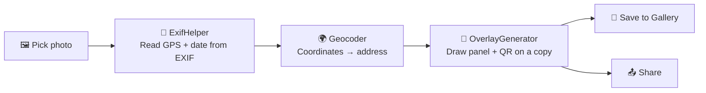

<div align="center">

# 📍 GeoTag Photo Stamp — Location Stamps for Your Existing Photos

**An Android app that reads the location saved inside a photo you have already taken and stamps it onto the picture: place name, full address, coordinates, date and time, plus a QR code that opens the spot in Google Maps.**


[Overview](#-overview) • [Features](#-features) • [How It Works](#-how-it-works) • [Tech Stack](#-tech-stack) • [Getting Started](#-getting-started) • [Permissions](#-permissions) • [Limitations](#-limitations)

</div>

---

## 📋 Overview

Geo-tag camera apps stamp location on a photo **while you take it**. **GeoTag Photo Stamp** does it **afterwards**, for photos already in your gallery.

Pick a photo, tap **Generate Tag**, and the app draws a clean location panel at the bottom of the image: the place, the address, the exact coordinates, the date and time the photo was taken, and a **QR code** that opens that spot on Google Maps. Then save it to your gallery or share it.

---

## ✨ Features

- 🖼️ **Pick any photo** from your device
- 📍 **Reads the GPS location** stored in the photo's EXIF data
- 🏙️ **Reverse geocoding** — turns coordinates into a short location (city, state, country) and a full street address
- 🕒 **Reads the date and time the photo was taken** and shows it as, for example, *Saturday, 14/06/2025 04:30 PM*
- 🏷️ **Location panel** drawn on the photo with a semi-transparent dark background, title, address, latitude / longitude and date
- 🔳 **QR code** inside the panel that opens the location in Google Maps
- 📐 **Adaptive layout** — text and QR size scale with the photo's width, and the panel grows to fit long addresses without overflowing
- 💾 **Save to Gallery** as a JPEG in `Pictures/`
- 📤 **Share** the stamped photo through any app
- 🎨 Material 3 interface built with Jetpack Compose

---

## ⚙️ How It Works



| Step | Component | What happens |
|---|---|---|
| 1 | `MainActivity` | You pick a photo; the app asks for media and location-access permission |
| 2 | `ExifHelper` | Reads the date and GPS coordinates with `ExifInterface`, then uses Android's `Geocoder` to get the city, state, country and full address |
| 3 | `OverlayGenerator` | Draws the stamp on a **copy** of the photo using Canvas, and generates the QR code with ZXing |
| 4 | `MainActivity` | Saves the result with `MediaStore` or opens the share sheet |

Your **original photo is never modified**. The stamped image is saved as a new file.

---

## 🛠️ Tech Stack

| Layer | Technology |
|---|---|
| **Language** | Kotlin |
| **UI** | Jetpack Compose + Material 3 |
| **Image loading** | Coil |
| **EXIF** | AndroidX `ExifInterface` |
| **QR code** | ZXing core |
| **Location → address** | Android `Geocoder` |
| **Storage** | `MediaStore` |
| **Min / target SDK** | 24 / 36 |

---

## 📁 Project Structure

```
GeoLocation/
└── app/src/main/
    ├── AndroidManifest.xml
    └── java/com/geolocation/geoloction/
        ├── MainActivity.kt        # Compose UI, photo picker, save & share
        ├── ExifHelper.kt          # EXIF reading + reverse geocoding
        ├── OverlayGenerator.kt    # Canvas stamp + QR code drawing
        └── ui/theme/              # Color, Theme, Type
```

---

## 🚀 Getting Started

### Prerequisites

- **Android Studio** (latest stable)
- An Android phone or emulator running **Android 7.0 (API 24)** or newer
- An internet connection on the device (the address lookup may need it)

### Run

```bash
git clone https://github.com/IshanPatel1912/GeoLocation.git
```

1. Open the folder in **Android Studio** and let Gradle sync.
2. Connect a device or start an emulator.
3. Click **Run ▶**.

### Build an APK

**Build → Build Bundle(s) / APK(s) → Build APK(s)**, or:

```bash
./gradlew assembleRelease
```

### Using the app

1. Tap **Pick Photo** and choose a picture.
2. Tap **Generate Tag** to create the stamp.
3. Tap **Save to Gallery** or **Share**.

---

## 🔐 Permissions

| Permission | Why it is needed |
|---|---|
| `READ_MEDIA_IMAGES` / `READ_EXTERNAL_STORAGE` (Android 12 and below) | To open the photo you choose |
| `ACCESS_MEDIA_LOCATION` | Android hides GPS data from photos unless the app has this permission, so it is required to read the location |
| `INTERNET` | Used by the reverse geocoder to look up addresses |

---

## ⚠️ Limitations

- **The photo must already contain GPS data.** The app reads the location saved in the photo; it does not add coordinates to a photo that has none. Photos from messaging apps and screenshots usually have their location removed, and your camera needs *Location tags* switched on. For photos with no GPS data the stamp shows "Unknown Location" and "Coordinates Unavailable".
- The original file's EXIF data is not rewritten. The location is added **visually** onto a new copy.
- Address text depends on what Android's geocoder returns for that area.

---

## 🗺️ Roadmap

- [ ] Choose the panel position, size and colours
- [ ] Batch-stamp several photos at once
- [ ] Pick a location on a map for photos that have no GPS data
- [ ] Add a custom note or watermark

---

## 👤 Author

**Ishan Patel** — Undergraduate student, Pandit Deendayal Energy University (PDEU)

[](https://github.com/IshanPatel1912)

---

<div align="center">

**Built with ❤️ using Kotlin and Jetpack Compose**

[🔝 Back to top](#-geotag-photo-stamp--location-stamps-for-your-existing-photos)

</div>
